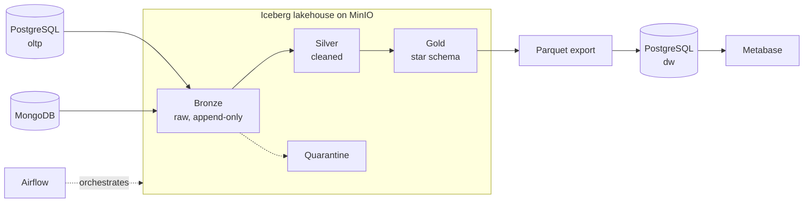
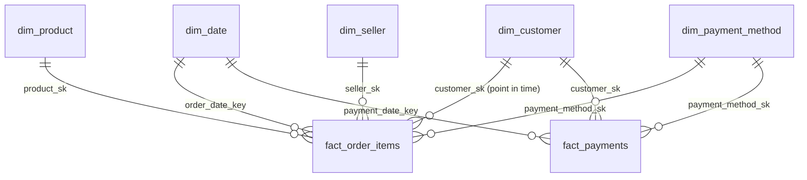

# marketplace-lakehouse

A batch data platform for an Indian online marketplace. It ingests customers, sellers, products,
orders, payments and reviews from PostgreSQL and MongoDB, lands them in an Iceberg lakehouse on
object storage, cleans them, models them as a star schema, checks data quality after every layer
and serves the result to a SQL warehouse and dashboards. Everything is open source and runs on
one laptop.

## The problem

Operational databases are built for the application, not for analysis. The data in them contains
duplicate orders from checkout retries, orders without a customer, payments with impossible
amounts, order lines pointing at orders that do not exist, and rows that change after they were
first read. Customers also move and change loyalty tier, so "revenue by city" has a different
answer depending on whether history is kept.

This project turns that into tables an analyst can trust:

- incremental loads that can be re-run or backfilled for any date without duplicating data;
- bad rows quarantined with a reason, never dropped silently;
- a star schema with a slowly changing customer dimension and point-in-time fact loads;
- quality gates that stop a batch before bad data reaches the next layer;
- a measured answer to "do the quality checks actually work?".

## Architecture



| Layer | What it holds | How it is written |
| --- | --- | --- |
| Bronze | Source rows as they are, plus load metadata | Watermark extraction; each batch overwrites its own partition |
| Silver | One current, cleaned row per business key | Latest version wins; rule breakers go to quarantine |
| Gold | 5 dimensions, 2 facts, 1 daily aggregate | Dimension merges; fact partitions rebuilt by order month |
| `dw` | The Gold tables in PostgreSQL | Parquet export, `COPY` into staging, atomic swap |

Processing is PySpark 3.5 in local mode. Airflow 3 runs one task per table per layer, with a
quality gate between layers. Details: [docs/ARCHITECTURE.md](docs/ARCHITECTURE.md).

## Data model



- `fact_order_items`: one row per order line. `fact_payments`: one row per payment attempt.
- `dim_customer` is SCD Type 2 on city, state, pincode and loyalty tier. Facts point at the
  customer version that was valid when the order was placed.
- Every dimension has an unknown member (key `-1`), so a missing dimension row never drops a fact.
- Facts are partitioned by order month with Iceberg hidden partitioning.

Grain, keys and SCD2 rules: [docs/DATA_MODEL.md](docs/DATA_MODEL.md). Every Gold column:
[docs/DATA_DICTIONARY.md](docs/DATA_DICTIONARY.md).

## Quickstart

Requirements: Docker Desktop with about 8 GB of memory for Docker, and Python 3.11 or newer on the
host. Nothing else is installed on the host; project code runs inside containers.

```bash
git clone <this repository> && cd marketplace-lakehouse
```

```bash
python scripts/dev.py up
```

```bash
python scripts/dev.py demo
```

The first `up` builds one image and downloads four jars, which takes several minutes. Use
`python scripts/dev.py demo --small` for a run that finishes much sooner on a tiny dataset.

## What you will see after `demo`

`demo` seeds the sources, loads day 0 as a full snapshot, simulates three more days and loads
each one incrementally, prints the quality report, runs a fifth day through Airflow, compacts the
tables and provisions Metabase.

When it finishes:

- **Airflow** at http://localhost:8080 shows the `daily_marketplace_pipeline` run for the fifth
  day with 31 successful tasks, grouped as extract, quality gate, Silver, gate, Gold, gate,
  publish.
- **Metabase** at http://localhost:3000 has three dashboards in the "Marketplace Lakehouse"
  collection: Sales Overview, Customer and Retention, and Pipeline Health. The login is the
  `METABASE_ADMIN_*` pair in `.env`.
- **MinIO** at http://localhost:9001 shows the Iceberg files under `lake/warehouse/` and the
  Parquet exports under `warehouse-exports/gold/`.
- **`reports/defect_reconciliation.md`** holds the precision and recall table, and
  **`reports/demo_timings.json`** the duration of every demo step.
- The terminal prints the quality summary for the latest batch: 4 warnings at Bronze (the
  injected source problems), and every Silver and Gold check passing.

## Headline results

Measured on this project's default profile, on one Windows 11 laptop with Docker Desktop
(WSL2, 4 CPUs and 7.8 GB given to Docker), Spark in local mode. Reproduce with
`python scripts/dev.py demo`.

### Volumes

| | Rows |
| --- | ---: |
| Source rows at day 0 (20,000 customers, 500 sellers, 5,000 products, 202,184 orders, 336,772 order lines, 216,708 payments, 52,574 reviews) | 838,786 |
| Source rows inserted or updated per simulated day | about 7,300 |
| `fact_order_items` after 5 days | 342,165 |
| `fact_payments` after 5 days | 220,354 |
| `dim_customer` versions after 5 days (20,160 customers, 560 closed versions) | 20,721 |
| `agg_daily_sales` | 42,509 |
| Rows held in quarantine after 5 days, across 5 rules | 5,203 |

### Defect detection, scored against the generator's ledger

The generator injected 5,201 defects of seven kinds over four days and recorded each one. The
pipeline flagged exactly those records: no misses and no false alarms.

| Defect type | Injected | Detected | True positives | Precision | Recall |
| --- | ---: | ---: | ---: | ---: | ---: |
| duplicate_order | 1016 | 1016 | 1016 | 100.0% | 100.0% |
| future_order_date | 1016 | 1016 | 1016 | 100.0% | 100.0% |
| orphan_order_item | 1016 | 1016 | 1016 | 100.0% | 100.0% |
| non_positive_amount | 1098 | 1098 | 1098 | 100.0% | 100.0% |
| null_customer_id | 1016 | 1016 | 1016 | 100.0% | 100.0% |
| late_arriving_update | 38 | 38 | 38 | 100.0% | 100.0% |
| schema_drift | 1 | 1 | 1 | 100.0% | 100.0% |
| all types | 5201 | 5201 | 5201 | 100.0% | 100.0% |

What this result does and does not prove is discussed in
[docs/DATA_QUALITY.md](docs/DATA_QUALITY.md).

### Pipeline timings

| Step | Duration |
| --- | ---: |
| Seed the sources (838,786 rows into PostgreSQL and MongoDB) | 41 s |
| Initial full load: all layers, 104 checks, publish to `dw` | 117 s |
| Incremental day, same steps, run from the CLI (three days: 106 s, 93 s, 90 s) | 97 s average |
| Incremental day through Airflow (31 tasks, one Spark session each) | 10 min 38 s |
| Re-run of all 104 checks plus the defect report | 50 s |
| Maintenance of all 40 tables (229 run-log files compacted into 1) | 83 s |
| Metabase provisioning (3 dashboards, 24 cards) | 16 s |

Batch durations are the pipeline's own measurements. All five batches passed every
error-severity check, with no failed step and no SLA breach.

An incremental day takes almost as long as the full load because fixed costs dominate at this
size: about 40 steps each commit to Iceberg, the checks scan whole Silver and Gold tables, and
`dw` is reloaded in full. The Airflow run is slower still because each of its 31 tasks starts
its own JVM.

## Repository layout

```
analytics/
  queries/            14 business queries against dw, each with its question in the header
  dashboards/         Metabase dashboards as YAML: card SQL, chart type and size
config/
  dq/                 Quality checks per layer, and which rule detects which injected defect
  publish.yml         Tables published to dw, with keys and indexes
dags/                 Airflow DAGs; wiring only
docker/               Image definition and platform database init
docs/                 Architecture, data model, dictionary, quality rules, operations, AWS mapping
  decisions/          Eight architecture decision records
scripts/
  dev.py              Developer CLI (the only entry point you need)
  fetch_jars.py       Pinned Spark jars with checksums
src/                  The `marketplace` Python package
  generator/          Deterministic source data, order lifecycle, defect injection, ledger
  sources/            Readers for PostgreSQL, MongoDB and the in-memory test store
  bronze/             Watermark extraction, checkpoints, schema evolution
  silver/             Table definitions, rules, quarantine, merge
  gold/               Star schema builders; transformations are the SQL files in gold/sql/
  dq/                 Check types, YAML loader, runner, detection scoring
  publish/            Parquet export and staged bulk load into dw
  ops/                Run log, pipeline status, Iceberg maintenance
  bi/                 Metabase provisioning
  pipeline.py         Every pipeline step as a function, used by Airflow and by the CLI
  orchestration.py    The functions the DAGs call
tests/
  unit/               Each module in isolation, on a local Spark session
  integration/        Whole pipeline on the small profile; real PostgreSQL and MongoDB
  analytics/          Every query against a hand-built star schema with hand-computed answers
```

## Commands

| Command | Purpose |
| --- | --- |
| `python scripts/dev.py up` / `down` / `reset` | Start, stop, or wipe the stack |
| `python scripts/dev.py seed [--small]` | Recreate the sources as of day 0 |
| `python scripts/dev.py advance --days N` | Simulate N more days of source activity |
| `python scripts/dev.py run [--date D] [--airflow]` | Run pending dates, or one date, optionally through Airflow |
| `python scripts/dev.py dq` | Re-run checks and print defect detection precision and recall |
| `python scripts/dev.py test` | Run the test suite with coverage |
| `python scripts/dev.py lint [--fix]` | Lint and format checks |
| `python scripts/dev.py demo [--small]` | The whole story end to end |

Backfills, re-runs, failure handling and the schema change runbook:
[docs/OPERATIONS.md](docs/OPERATIONS.md).

## Design decisions in brief

| Decision | Reason | Record |
| --- | --- | --- |
| Iceberg tables | Atomic batch replacement, `MERGE`, schema evolution, time travel | [ADR 1](docs/decisions/0001-iceberg-table-format.md) |
| JDBC catalog on PostgreSQL | Atomic commits on object storage without another service | [ADR 2](docs/decisions/0002-jdbc-catalog.md) |
| Watermark extraction, not CDC | No extra infrastructure; cannot see deletes or intermediate states | [ADR 3](docs/decisions/0003-watermark-extraction-instead-of-cdc.md) |
| SCD2 only on customers | History matters for city and tier; Type 2 has a cost elsewhere | [ADR 4](docs/decisions/0004-scd2-only-on-customers.md) |
| Own quality framework | Failing keys in our own tables make detection measurable | [ADR 5](docs/decisions/0005-own-data-quality-framework.md) |
| `dw` in PostgreSQL | Stand-in for a columnar warehouse, with the same load pattern | [ADR 6](docs/decisions/0006-postgres-as-serving-warehouse.md) |
| Airflow 3.3.2 | Supported release; SLAs via timeouts and a recorded breach flag | [ADR 7](docs/decisions/0007-airflow-3-and-sla-handling.md) |
| Spark local mode | Fits the memory budget; proves correctness, not scale | [ADR 8](docs/decisions/0008-spark-local-mode.md) |

## Testing

`python scripts/dev.py test` runs everything inside the project image.

It covers each module in isolation, the whole pipeline end to end on the small profile, every
analytics query against hand-computed answers, and re-running batches to prove idempotency.

The pipeline tests need no services: the generator writes to an in-memory store, Spark runs in
local mode and Iceberg uses a file-system catalog. Tests that need PostgreSQL or MongoDB use
scratch databases and are skipped when `TEST_PG_DSN` or `TEST_MONGO_URI` is not set.

## Limitations

- **Not deployed to a cloud.** [docs/AWS_MAPPING.md](docs/AWS_MAPPING.md) maps each component to
  its AWS equivalent and lists what a migration would change. None of it has been run on AWS.
- **Small scale, one JVM.** Spark runs in local mode. The timings above say nothing about cluster
  performance, and per-step overhead dominates at this data size.
- **Synthetic data.** The defects are ones the generator was built to inject, each with a rule
  aimed at it. The detection result shows that nothing is lost or falsely flagged between
  injection and reporting; it does not show the checks would catch problems nobody anticipated.
- **Watermark extraction.** Hard deletes and intermediate row states are not captured, and
  re-extracting an old date reads the source as it is now.
- **SCD2 is batch-granular.** Two changes to a customer between runs produce one version, and an
  out-of-order version is ignored instead of being inserted into history.
- **Full reload of `dw`.** Every batch reloads each published table in full.
- **Schema drift stops at Bronze.** New source columns are added to Bronze and logged
  automatically; promoting them further is a documented manual step. Removed columns and type
  changes stop the batch and need a person.
- **No alerting.** Failures are recorded and shown on the Pipeline Health dashboard; nothing is
  sent to anyone.
- **Development-grade security.** Credentials come from a local `.env` file; there is no
  encryption or role separation.
- **Community MinIO image.** Official MinIO community images are no longer published, so the
  stack pins a community-maintained build of the same server.
