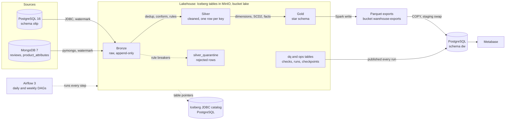

# Architecture

## Overview

Processing is PySpark in local mode. Each layer is followed by a quality gate; a failed
error-severity check stops the batch before the next layer starts.

## Components

| Service | Image | Role | Memory limit | Host port |
| --- | --- | --- | --- | --- |
| `postgres-source` | `postgres:16.16` | OLTP source, schema `oltp` | 384 MB | 5433 |
| `mongo` | `mongo:7.0.48` | Document source | 512 MB | 27018 |
| `minio` | `pgsty/minio:RELEASE.2026-08-04T00-00-00Z` | S3-compatible object store | 384 MB | 9000, 9001 |
| `postgres-platform` | `postgres:16.16` | Iceberg catalog, `dw`, Airflow and Metabase metadata | 512 MB | 5434 |
| `airflow-apiserver` | project image | Airflow UI and task execution API | 1024 MB | 8080 |
| `airflow-dag-processor` | project image | Parses DAG files | 640 MB | |
| `airflow-scheduler` | project image | Schedules and runs tasks (LocalExecutor, Spark driver) | 2560 MB | |
| `metabase` | `metabase/metabase:v0.64.6.2` | Dashboards on `dw` | 1536 MB | 3000 |
| `tools` | project image | On-demand container for `scripts/dev.py` commands | 2560 MB | |

The always-on limits add up to about 7.4 GB. Actual use is lower: the scheduler stays near
250 MB until a task starts a Spark driver, and `tools` only exists while a command runs.
`airflow-init` is a one-shot container that migrates the Airflow database and exits.

The project image (`docker/Dockerfile`) is the official Airflow image plus a JRE, the pinned
Spark jars and this package installed in editable mode. The repository is bind-mounted over the
installed copy, so code changes do not need a rebuild.

The MinIO project no longer publishes official community images. The stack pins a community-maintained
build of the same open-source server. Only the S3 API is used, so any S3-compatible store would
work with a change of endpoint.

## Verified version set

These versions were built and run together; changing one usually means changing its neighbours.

| Component | Version | Why this one |
| --- | --- | --- |
| Python | 3.11 | Supported by Airflow 3.3 and PySpark 3.5 |
| Apache Airflow | 3.3.2 | See ADR 7 |
| Apache Spark / PySpark | 3.5.9 (Scala 2.12) | Long-lived 3.5 line with an Iceberg runtime |
| JDK | Temurin 17.0.21 | Highest LTS release Spark 3.5 supports |
| Iceberg Spark runtime | `iceberg-spark-runtime-3.5_2.12` 1.10.2 | Matches Spark 3.5 and Scala 2.12 |
| Hadoop AWS | 3.3.4 | Spark 3.5.9 is built against Hadoop 3.3.4 |
| AWS SDK bundle | 1.12.262 | The version Hadoop 3.3.4 is built against |
| PostgreSQL JDBC driver | 42.7.14 | Used by Spark JDBC reads and the Iceberg JDBC catalog |
| psycopg, pymongo, pyarrow | 3.3.5, 4.18.1, 25.0.1 | Taken from the Airflow 3.3.2 constraints file |

The four jars are declared once, with checksums, in `scripts/fetch_jars.py`.

## Layers

**Bronze** (`bronze.*`). One table per source table or collection, partitioned by `_batch_id`.
Rows are landed as they are, plus `_batch_id`, `_ingested_at`, `_source_system` and
`_extract_watermark`. MongoDB documents are stored as raw JSON. A batch replaces its own
partition, so re-running it cannot duplicate rows.

**Silver** (`silver.*`). The current state of each business key. For each batch: take the latest
Bronze version per key, trim and conform values, evaluate the hard rules, send rule breakers to
`silver_quarantine.<table>` with the rule id, the reason and the original payload, and `MERGE`
the rest into Silver where the incoming `updated_at` is strictly newer.

**Gold** (`gold.*`). The star schema described in [DATA_MODEL.md](DATA_MODEL.md): five
dimensions, two facts partitioned by order month, one daily aggregate.

**Publish**. Each Gold table is exported to Parquet and bulk-loaded into `dw`. The run log,
check results, schema changes and a quarantine summary are published at the end of every run,
including failed ones.

## The batch

A batch is one logical date. It covers source changes with `updated_at` before midnight UTC at
the end of that date. `batch_id` is the date itself, so two runs for the same date address the
same partitions and overwrite each other.

Extraction reads the window `[previous watermark - 1 hour, batch end)`. The previous watermark is
the end of the latest committed batch with an earlier `batch_id`, read from
`ops.extract_checkpoints`. With no earlier batch the window has no lower bound: a full snapshot.

## Operational tables

| Table | Content |
| --- | --- |
| `ops.extract_checkpoints` | Watermarks, rows extracted and status per source table and batch |
| `ops.pipeline_runs` | One row per step: rows in, out and quarantined, duration, SLA flag, status |
| `dq.check_results` | One row per check and run: status, observed value, threshold |
| `dq.failed_rows` | Keys of the rows that failed a check |
| `dq.schema_changes` | Every detected source schema change |

## Code layout

DAG files contain no logic. They call `marketplace.orchestration`, which opens a context and
calls one function in `marketplace.pipeline`. The command-line runner calls the same functions,
so the two ways of running the pipeline behave identically.
