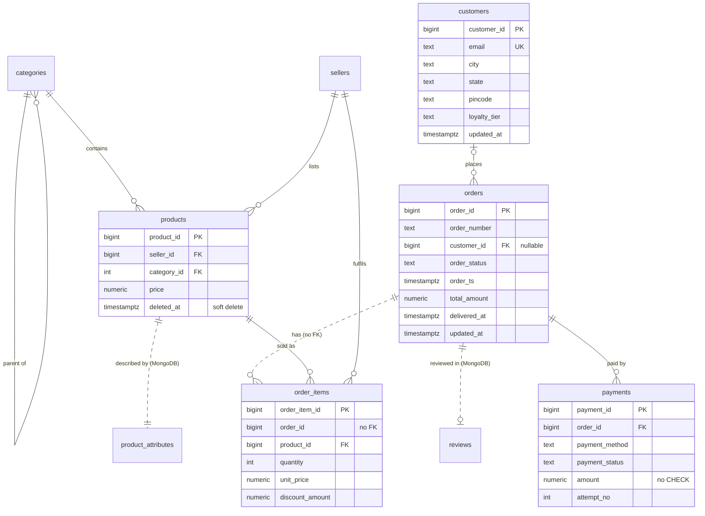
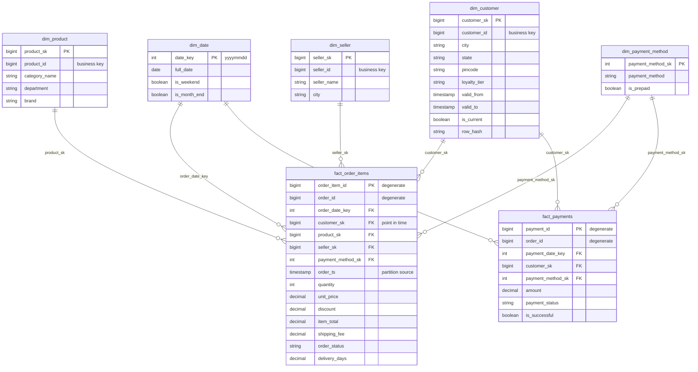

# Data model

## Source model (PostgreSQL `oltp` and MongoDB)



Every table has `created_at` and `updated_at`. The full DDL, with constraints and indexes, is in
`src/generator/sql/oltp_schema.sql`.

Three constraints are missing on purpose, because they are how the defects the pipeline must
handle get into a real system: `orders.customer_id` is nullable, `orders.order_number` is not
unique, and `order_items.order_id` has no foreign key. `payments.amount` has no `CHECK`.

MongoDB holds `reviews` (rating, text, helpful votes, a nested `seller_reply`) and
`product_attributes` (an `attributes` sub-document whose keys differ by department).

## Star schema (Gold, published to `dw`)



Column-level descriptions are in [DATA_DICTIONARY.md](DATA_DICTIONARY.md).

## Grain and keys

| Table | Grain (one row per) | Primary key | Notes |
| --- | --- | --- | --- |
| `fact_order_items` | order line | `order_item_id` | `order_id` and `order_item_id` are degenerate keys |
| `fact_payments` | payment attempt | `payment_id` | An order has one row per attempt, failed ones included |
| `agg_daily_sales` | date, department, customer city | `date_key, category, city` | Derived from `fact_order_items` |
| `dim_customer` | customer version | `customer_sk` | Business key `customer_id` repeats across versions |
| `dim_seller` | seller | `seller_sk` | Type 1 |
| `dim_product` | product | `product_sk` | Type 1, category tree flattened in |
| `dim_date` | calendar day | `date_key` | 2024-01-01 to 2029-12-31 |
| `dim_payment_method` | payment method | `payment_method_sk` | Fixed set |

Measures in `fact_order_items`:

- `quantity`, `unit_price`, `discount` and `item_total` (`quantity * unit_price - discount`) are
  per line. `item_total` and `quantity` are fully additive.
- `shipping_fee` is charged once per order. It is stored on the order's first line and is zero on
  the others, so summing it over any set of lines gives the correct total.
- `delivery_days` is the time from order to delivery in days, null until delivered. It is an
  order-level attribute repeated on each line, so it must be averaged over distinct orders.
- `order_status` is the order's latest status. It is updated in place when the order month is
  rebuilt.

GMV is the sum of `item_total` over lines whose order is not cancelled. Returned orders count.

`agg_daily_sales.orders` counts orders with at least one line in the department, so an order that
spans two departments is counted in both. It is not additive across departments.

## Surrogate keys and unknown members

Dimensions use integer surrogate keys assigned when a member (or, for customers, a version) is
first inserted: the current maximum key plus a row number. Keys of existing rows never change.

Every dimension has an unknown member with surrogate key `-1`. A fact row whose dimension lookup
finds nothing gets `-1` instead of being dropped, so fact loads never lose rows to a missing or
late dimension member. In practice this is where orders without a `customer_id` and orders whose
only payment was rejected end up.

## SCD Type 2 rules for `dim_customer`

Tracked attributes: `city`, `state`, `pincode`, `loyalty_tier`. `row_hash` is the SHA-256 of
those four values.

| Situation | Effect |
| --- | --- |
| New customer | Insert a version with `valid_from = 1900-01-01`, `valid_to = 9999-12-31`, `is_current = true` |
| Tracked attribute changed, change newer than the current version | Close the current version (`valid_to = change time`, `is_current = false`) and insert a new one starting at the change time |
| Nothing tracked changed | No effect, even if the source row has a newer `updated_at` |
| Incoming version older than the current one | Ignored |
| Same batch applied again | No effect: the hash equals the current version's hash |

The change time is the source row's `updated_at`. Validity ranges are half-open,
`[valid_from, valid_to)`, and consecutive versions share a boundary, so every instant maps to
exactly one version.

The first version starts at 1900-01-01 rather than at the customer's creation time. Orders placed
before the pipeline first saw the customer therefore still find a version.

Personal data (name, email, phone) stays in Silver and is not published to Gold.

## Point-in-time join

`fact_order_items.customer_sk` is the version that was valid when the order was placed:

```sql
LEFT JOIN gold.dim_customer AS customer
       ON customer.customer_id = orders.customer_id
      AND orders.order_ts >= customer.valid_from
      AND orders.order_ts < customer.valid_to
```

Joining facts to `dim_customer` on `customer_sk` therefore reports each order under the city and
tier of the time. To report under today's attributes instead, go from the fact's version to the
current version of the same `customer_id`. `analytics/queries/07_revenue_by_city_point_in_time.sql`
shows both side by side.

## Partitioning

Both facts are partitioned with Iceberg hidden partitioning on `months(order_ts)`.

- Orders keep changing for about a month after they are placed (delivery, return, refund) and
  then go quiet. A daily batch therefore touches the current month and usually the previous one.
  Rebuilding whole order-month partitions makes the load idempotent and keeps older months
  untouched.
- Analytical queries filter by time. Because the partition is derived from `order_ts`, a filter
  on `order_ts` prunes files without the query naming a partition column.
- Monthly, not daily: at this volume a day is a few megabytes. Daily partitions would mean
  thousands of small files with no pruning benefit.

Bronze tables are partitioned by `_batch_id`, the unit in which they are written and replaced.
Dimensions, Silver tables and the aggregate are small and unpartitioned.
